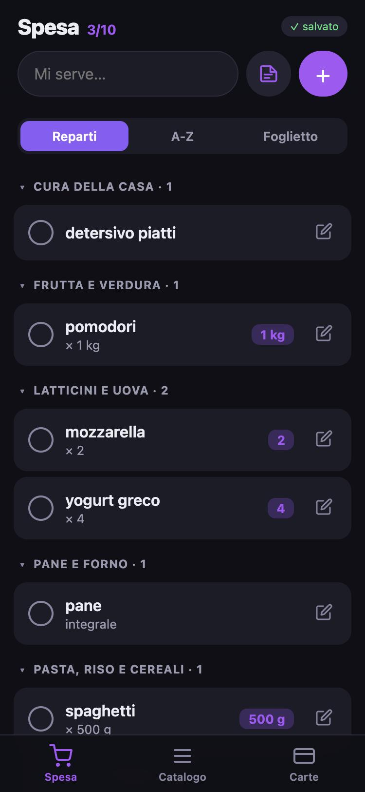
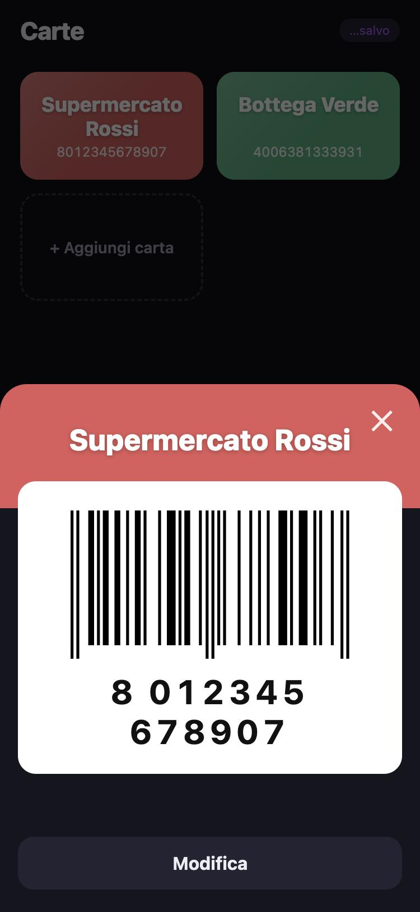

# grocery-list-pwa

A grocery list that works offline, built as a single HTML file plus a ~120-line Cloudflare Worker.
No framework, no build step, no dependencies to install. The interface is in Italian.

It started as the list my partner and I share when shopping, so it is designed for one thing:
standing in a supermarket aisle with a bad signal, adding "2 latte" in three seconds and showing the
loyalty card at the till.

<p>
  
  
</p>

## What it does

- **Shopping list** with three views of the same data: grouped by **department** (aisle order),
  **A–Z**, and a **post-it** you can type on line by line. Tap a row to tick it; ticked items move to
  "In the cart" and **Finish trip** clears them.
- **Catalogue**: everything you have ever added stays saved, so next time you re-add it with one tap.
  Each product has a department, quantity, notes and a favourite star.
- **Quick note**: type `2 latte`, `latte x2`, `1kg pomodori` or `pane — integrale` and it extracts the
  quantity and the details, and **guesses the department** from a dictionary of a few hundred Italian
  grocery words (the longest match wins, so "pomodori pelati" goes to canned goods, not to vegetables).
  Items typed this way are throwaway: they live in the list but not in the catalogue.
- **Loyalty cards**: tap a card to show its barcode full screen (CODE128, EAN-13, EAN-8, UPC, CODE39,
  ITF-14). The screen stays awake while the barcode is open. Codes are normalised before drawing: a
  12-digit UPC is an EAN-13 with a leading zero, and a wrong check digit is flagged instead of
  silently drawing a different code.
- **Works offline**: it is an installable PWA. The last state is kept in `localStorage` and the page is
  cached by a service worker (network first, so updates arrive on the next launch).
- **Undo** after "Finish trip", because a stray tap there would otherwise cost you the whole list.

## How sync works

State is one JSON blob in Workers KV: `{ version, products[], cards[], deleted{} }`. The client is
**local-first**: it shows what is in `localStorage` immediately and syncs when it can.

Two phones that edit different things while offline must not erase each other, so:

- every product and card carries `u`, the time it was last touched;
- deleting something leaves a **tombstone** in `deleted` (kept 30 days) so the other device does not
  bring it back;
- the server refuses (`409`) a write that started from an older `version` and returns its state; the
  client then **merges item by item** (newest `u` wins, tombstones respected) and retries once;
- the app re-syncs when it comes back to the foreground and every 20 seconds while open, but never
  redraws while you are typing or have a sheet open.

Known limits, on purpose: one shared password (no per-user accounts), and KV has no atomic
compare-and-swap, so two writes landing in the same instant can still interleave. The merge makes
that recoverable rather than impossible. Loyalty card numbers are stored in KV in clear text.

## Run it

```bash
npm install -g wrangler
cp .dev.vars.example .dev.vars      # choose a password and a long random string
wrangler dev
```

## Deploy

```bash
npx wrangler kv namespace create SPESA     # paste the id into wrangler.toml
npx wrangler secret put APP_PASSWORD       # the password you log in with
npx wrangler secret put AUTH_SECRET        # a long random string, signs the 30-day tokens
npx wrangler deploy
```

Open the URL, log in, then on iPhone use *Share → Add to Home Screen*. When you change the HTML, bump
`CACHE` in `public/sw.js` so installed copies refresh.

## Layout

```
public/index.html     the whole app (UI, sync, note parser, barcode normaliser)
public/sw.js          service worker (offline shell)
src/worker.js         login (HMAC-SHA256 token) + GET/PUT /api/state with the version check
wrangler.toml         assets + KV binding
```

## Credits and licence

Barcodes are drawn with [JsBarcode](https://github.com/lindell/JsBarcode) (MIT, © Johan Lindell),
bundled as `public/jsbarcode.min.js`. This project is MIT licensed, see `LICENSE`.
